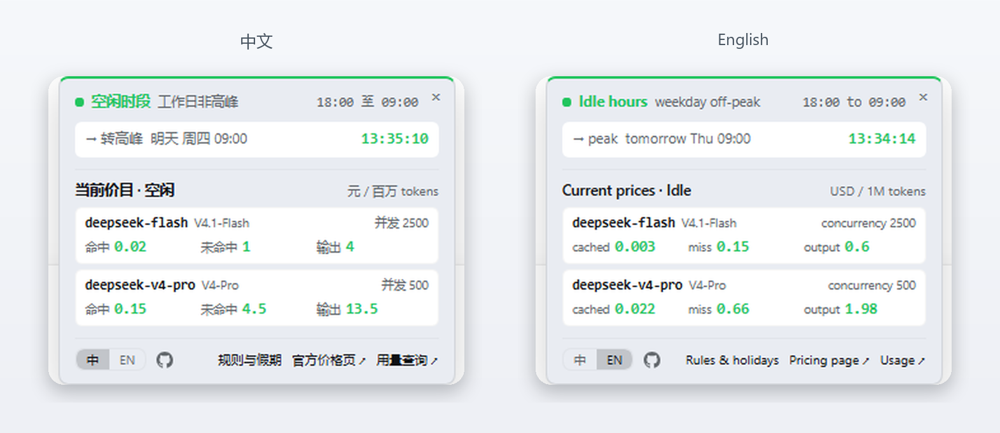
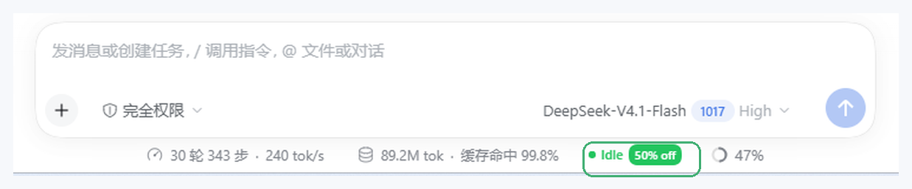

# DeepSeek Half Price

*English · [中文](README.zh.md)*

A quiet chip in the composer status row that tells you whether DeepSeek is billing you at **peak or half price**. Hover it for the next switch, live prices, and Chinese holidays.



<p align="center">
  
  
  
</p>

## What you get

- **Static chip** — `● 空闲 五折` / `● Peak`. Changes only when the billing window changes; no countdown, no animation.
- **Popover** — current window, next switch with countdown, live price table, holidays, sync, official links.
- **10-minute warning** — `│ 09:00 涨价` appears just before the rate changes.
- **Quiet by design** — one timer per boundary, one holiday sync per 30 days, no telemetry.



## Install

| Way | Paste into **Settings → Plugins** |
| --- | --- |
| GitHub (recommended) | `https://github.com/shalom-lab/dsh-half-price` |
| Tarball | absolute path to a `pnpm pack` `.tgz` |
| Local | absolute path to the checkout |

Then **restart the harness** — client modules are cached by id. No dependencies, no build step, no install scripts.

Or hand it to an agent:

```text
Install this DeepSeek Harness plugin for me: https://github.com/shalom-lab/dsh-half-price
Use the plugin manager, confirm the dsh-half-price row is active, and tell me if a restart is needed.
```

## Pricing rule

| Window | Beijing time | Price |
| --- | --- | --- |
| Peak | Mon–Fri 09:00–12:00, 14:00–18:00, excluding holidays | Full |
| Idle | everything else, including weekends and holidays | 50% |

Make-up workdays count as weekdays. The old `00:30–08:30` discount was retired in 2025.

[中文价格页](https://api-docs.deepseek.com/zh-cn/quick_start/pricing) · [English pricing page](https://api-docs.deepseek.com/quick_start/pricing/)

## Prices

Per 1M tokens; English mode shows the USD list from the English docs.

| Model | Window | Cached input | Miss input | Output |
| --- | --- | --- | --- | --- |
| `deepseek-flash` | idle | ¥0.02 | ¥1 | ¥4 |
| | peak | ¥0.04 | ¥2 | ¥8 |
| `deepseek-v4-pro` | idle | ¥0.15 | ¥4.5 | ¥13.5 |
| | peak | ¥0.30 | ¥9 | ¥27 |

## Holidays

- **Bundled**: 2026 and 2027, including 调休 workdays.
- **Synced**: other years come from [holiday-cn](https://github.com/NateScarlet/holiday-cn) through four mirrors, cached for 30 days.
- **Safe**: offline or all mirrors down, the bundled years still work.

## Language · Privacy

Follows the harness language; the `中 | EN` switch overrides it for this plugin. English keeps the Chinese festival names — `Spring Festival 春节`.

No telemetry, no account access. The only outbound request is the holiday sync.

## Development

```bash
node dev/logic-check.mjs      # windows, ranges, holidays, i18n parity
node dev/online-check.mjs     # real mirror fetch
node dev/mirror-check.mjs     # fallback and total failure
```

## License

[MIT](LICENSE).
