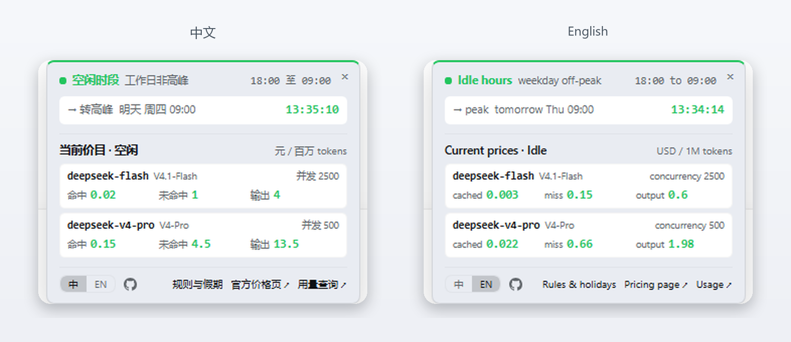

# DeepSeek 半价时段

*[English](README.md) · 中文*

一个安静的小胶囊，长在输入框下方的状态行里，告诉你 DeepSeek 现在是**原价还是半价**。悬停展开下次切换、实时价目和节假日。



<p align="center">
  
  
  
</p>

## 你会得到什么

- **静止的胶囊** —— `● 空闲 五折` / `● 高峰`。只在计费时段真的变了才变，没有倒计时、没有动画
- **弹层** —— 当前时段、下次切换倒计时、实时价目、节假日、同步、官方链接
- **提前 10 分钟提醒** —— 变价前胶囊尾巴出现 `│ 09:00 涨价`
- **全局状态点** —— 窗口右下角一个点，没有打开会话也能看到；开关就在语言切换的右边
- **安静** —— 每个边界一个定时器，假期数据 30 天同步一次，没有埋点


## 安装

| 方式 | 粘到 **设置 → 插件** |
| --- | --- |
| GitHub（推荐） | `https://github.com/shalom-lab/dsh-half-price` |
| tarball | `pnpm pack` 产出的 `.tgz` 绝对路径 |
| 本地目录 | 仓库目录的绝对路径 |

装完**重启 Harness**——客户端模块按 id 缓存。零依赖、免构建、无安装脚本。

也可以直接丢给 Agent：

```text
把这个 DeepSeek Harness 插件装到我的环境里：https://github.com/shalom-lab/dsh-half-price
请用插件管理器安装并启用，确认 dsh-half-price 这一行是 active，然后告诉我需不需要重启。
```

## 计费规则

| 时段 | 北京时间 | 价格 |
| --- | --- | --- |
| 高峰 | 周一至周五 09:00–12:00、14:00–18:00，不含法定节假日 | 原价 |
| 空闲 | 其余全部时间，含周末与节假日 | 半价 |

调休上班日按工作日计。旧的 `00:30–08:30` 错峰优惠已于 2025 年取消。

[中文价格页](https://api-docs.deepseek.com/zh-cn/quick_start/pricing) · [English pricing page](https://api-docs.deepseek.com/quick_start/pricing/)

## 价目

每百万 tokens；英文模式显示英文文档的美元价。

| 模型 | 时段 | 命中缓存 | 未命中 | 输出 |
| --- | --- | --- | --- | --- |
| `deepseek-flash` | 空闲 | ¥0.02 | ¥1 | ¥4 |
| | 高峰 | ¥0.04 | ¥2 | ¥8 |
| `deepseek-v4-pro` | 空闲 | ¥0.15 | ¥4.5 | ¥13.5 |
| | 高峰 | ¥0.30 | ¥9 | ¥27 |

## 假期

- **内置**：2026 与 2027，含调休上班日
- **同步**：其余年份来自 [holiday-cn](https://github.com/NateScarlet/holiday-cn)，四条镜像依次尝试，缓存 30 天
- **兜底**：离线或镜像全挂，内置年份照常工作

## 语言 · 隐私

默认跟随 Harness 的语言，底栏 `中 | EN` 可只给本插件覆盖。英文模式保留节日中文原名——`Spring Festival 春节`。

没有埋点、不碰账户，唯一的出站请求是假期同步。

## 开发

```bash
node dev/logic-check.mjs      # 时段、区间、假期、中英字典对齐
node dev/online-check.mjs     # 真实拉镜像
node dev/mirror-check.mjs     # 回退与全挂
```

## 许可

[MIT](LICENSE)。
